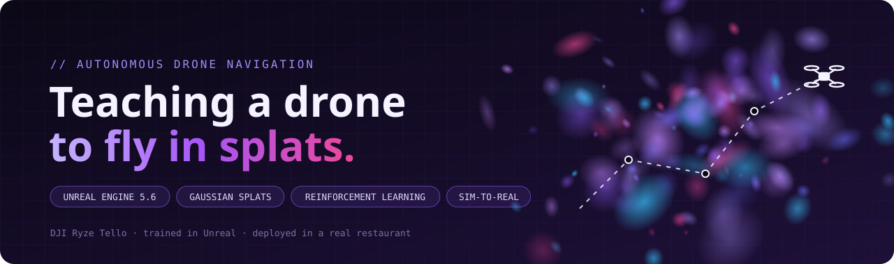
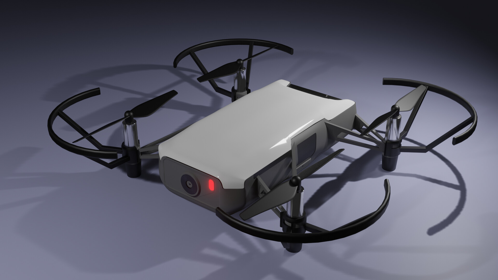
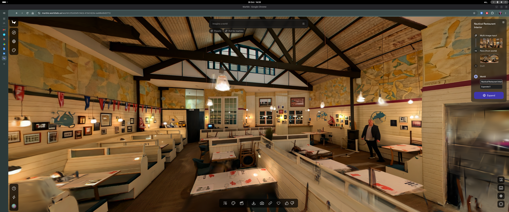
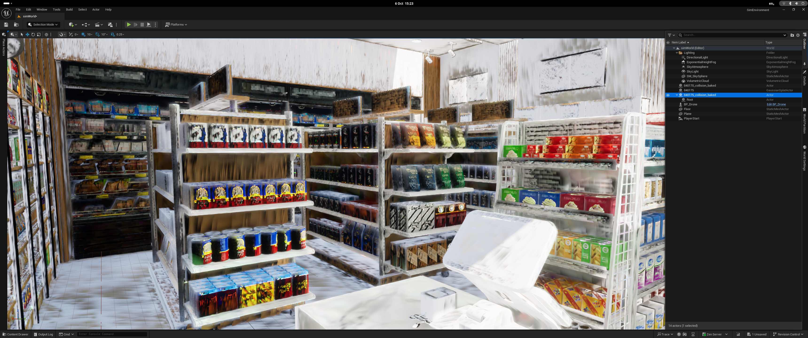
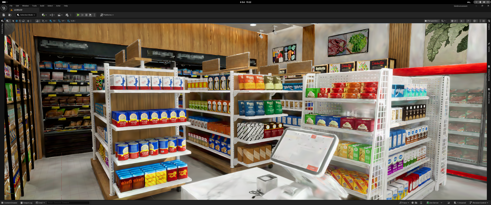
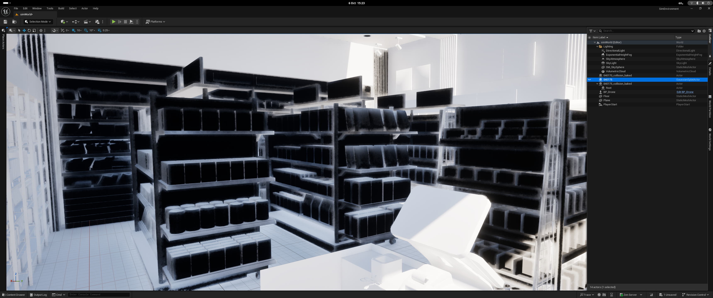

# Autonomous Drone Navigation with Reinforcement Learning

Reinforcement learning agent that teaches a drone to navigate autonomously in Unreal Engine, then deploys the learned policy on a real DJI Ryze Tello.


## Table of Contents

- [Overview](#overview)
- [Project Status](#project-status)
- [Tech Stack & Hardware](#tech-stack--hardware)
- [Guide](#guide)
    - [1. Building the Environments](#1-building-the-environments)
    - [2. Pre-Training Dataset (InteriorGS)](#2-pre-training-dataset-interiorgs)
    - [3. Simulation Setup in Unreal](#3-simulation-setup-in-unreal)
    - [4. Performance Validation](#4-performance-validation)
    - [5. First Test: One Environment](#5-first-test-one-environment)
    - [6. RL Training](#6-rl-training)
    - [7. Sim-to-Real Deployment](#7-sim-to-real-deployment)
- [Getting Started](#getting-started)
- [Repository Structure](#repository-structure)
- [Appendix: Drone Flight Basics](#appendix-drone-flight-basics)
- [References](#references)
- [License](#license)

---

## Overview

### The Goal

Train a drone inside `Unreal Engine` using reinforcement learning, then transfer the learned behaviour to a real-world drone (**sim-to-real**). 
The project combines robotic simulation, reinforcement learning policies, 3D reconstruction technics like Gaussian Splatting. 

### Motivation

Research suggests that photorealism is key to closing the sim-to-real gap,
the difference between how a robot behaves in simulation and in the real world.
Recently, companies have started using Unreal Engine in their robotics stacks
to improve how robots learn. So I wanted to explore this myself. Instead of training with existing platforms
like NVIDIA Isaac Sim or NVIDIA Cosmos, I'm building my own stack from scratch
to push what's possible with reinforcement learning in Unreal Engine.

### The Real-World Challenge

The drone will be deployed in an empty restaurant, where it must navigate
between tables and avoid obstacles.

Training is split into progressive stages, each building on the previous one.
The project succeeds when the drone can complete all of them:

1. **Turn to face a target**
2. **Fly to a point** in open space
3. **Stop at the point** without overshooting
4. **Reach a point around obstacles**

### How It Works

1. **Build realistic environments:** create a Gaussian splat replica of the restaurant, plus pre-training environments from the InteriorGS dataset.
2. **Simulate in Unreal:** import the environments and a drone model that matches the real Tello.
3. **Train with RL:** a Python agent sends actions and receives camera frames through `UnrealCV`.
4. **Deploy:** export the trained policy and run it on the real Tello.

---

## Project Status

| Stage | Status |
|-------|--------|
| Hardware and drone selection | ✅ Done |
| Environment creation research (photogrammetry, Gaussian splats, Unreal plugins) | ✅ Done |
| Virtual environment pipeline | ✅ Done |
| Import InteriorGS environment into Unreal | ✅ Done |
| Performance validation (editor vs packaged build) | ✅ Done |
| Restaurant replica environment | ⬜ Planned |
| Curate pre-training environments (up to 50) | ⬜ Planned |
| First test: drone flying and controlled through UnrealCV | 🔄 In progress |
| RL training | ⬜ Planned |
| Sim-to-real deployment on the Tello | ⬜ Planned |


---

## Tech Stack & Hardware

### Software

| Tool | Purpose                            |
|------|------------------------------------|
| `Unreal Engine 5.6` | Simulation and rendering           |
| `Linux Fedora 42` | OS                                 |
| `NanoGaussianSplatting` | Gaussian splat rendering in Unreal |
| `UnrealCV` | Bridge between Unreal and Python   |

> **TODO:** Add the Python / RL libraries 

### Hardware

| Component | Specification |
|-----------|---------------|
| `CPU` | Intel Core i5-14400F (10 cores / 20 threads) |
| `GPU` | NVIDIA GeForce RTX 5060 (8 GB VRAM) |
| `RAM` | 16 GB |
| `Storage` | 1 TB NVMe SSD |

### The Drone: DJI Ryze Tello



The Tello has a front-facing camera and a vision positioning system with a 3D infrared module on the underside. The simulated drone has to match these specs.

**Body dimensions**

| Description | Dimensions (bounding box) |
|-------------|---------------------------|
| `Body` | 98 × 92.5 × 41 mm |
| `Body + propellers` | 174 × 170 × 41 mm |
| `Body + propellers + guards` | 188 × 183 × 46 mm |

**General specs**

| Property | Value |
|----------|-------|
| `Weight` | 87 g |
| `Max speed` | 28.8 km/h |

**Front camera**

| Property | Value |
|----------|-------|
| `Position on body` | Front-centre, slightly below top |
| `FOV` | 82.6° |
| `Max image size` | 2592 × 1936 |
| `Video recording` | HD: 1280 × 720 |
| `FPS` | 30 |

**Vision positioning system**

| Property | Value |
|----------|-------|
| `Camera` | Front |
| `3D infrared module` | Underside |

---

## Guide

### 1. Building the Environments

#### 1.1 Why Visual Realism Matters

The Tello perceives its environment mainly through its front-facing camera, so realistic visual environments are critical for training **(this is my hypothesis)**. My focus is on representing the world as realistically as possible. Below are the techniques I explored, followed by the pipeline I chose.

#### 1.2 Photogrammetry (Point Clouds): What I Tried and Why I Dropped It

After weeks of testing, I moved on from photogrammetry for these reasons:

- **Hardware limits:** Photogrammetry depends heavily on local hardware. My RTX 5060 (8 GB VRAM) and 16 GB RAM fall behind with scenes of more than 400 images, while serious indoor projects can need up to 5,000. 
- **Software overhead:** `COLMAP` and `RealityScan` are resource-heavy on their
    own, which leaves less VRAM and RAM for the reconstruction itself and limits
    how large a scene I can process.
- **Camera quality:** Phone cameras don't deliver the quality needed. A dedicated camera like a used Canon 450D with proper lenses costs around £150, which isn't worth it for this project.
- **Shooting technique:** Blur is the enemy of photogrammetry, so you often end up reshooting locations several times.

| Tool | Results | Image |
|------|---------|-------|
| `Polycam` | Not accurate enough for reliable drone-training environments. Tested with an `iPhone 13 Pro`, `iPhone 15` and `iPhone 16 Pro Max`. |  |
| `RealityScan` | Best results of the photogrammetry tools. On `Linux` it only runs under `Wine`, so export, import and mesh editing aren't available. |  |

#### 1.3 Gaussian Splats with Marble

Alongside photogrammetry, I explored generative techniques. My favourite tool was `Marble` by World Labs. But testing the tool I realize marble is not a good option to generate
accurate and plausible 3d replicas with gaussian splats, so I move on of this one.



#### 1.4 Gaussian Splats with a 360° Camera and Spirula Studio

My current approach is to shoot the restaurant with a 360° camera (Insta360 x2) and train
the Gaussian splat locally with [`Spirula Studio`](https://github.com/MotivaCG/spirula-studio).
It fits this project's constraints well:

- **Runs on Linux** as a single binary
- **No separate COLMAP install**, so the heavy photogrammetry step is avoided
- **Fits in 8 GB of VRAM**, which matches my RTX 5060
- **Native 360° support**, so footage trains without undistortion

Unlike Marble, the result comes from real footage of the space rather than
generation, so it should be a more faithful replica.

**Status:** 🔄 Training in progress.

> **TODO:** Add the 360° camera model, how the space was shot, training time,


#### 1.5 Getting 3DGS into Unreal on Linux

`Unreal Engine` doesn't support 3D Gaussian Splats (3DGS) natively, so a plugin is needed. Most plugins are packaged for Windows only, and many public repos don't include the source code, so they can't be rebuilt for Linux.

| Plugin | Link | Verdict |
|--------|------|---------|
| `NanoGaussianSplatting` ⭐ | [GitHub](https://github.com/TimChen1383/NanoGaussianSplatting) | **Chosen.** Open source, compiles on Linux, and mimics Nanite's rendering system for efficient 3DGS rendering. |
| `GaussianSplatting` | [GitHub](https://github.com/Italink/GaussianSplattingForUnrealEngine) | Open source and compiles on Linux, but not optimised and very strict about `.ply` formatting. Breaks easily with compressed `.ply` files. |
| `unreal-splat` | [GitHub](https://github.com/JI20/unreal-splat) | Open source and compiles on Linux. Not tested yet. |
| `Volinga` | [Website](https://web.volinga.ai/#VolingaPlugin) | Paid. Doesn't compile on any Linux version I tried, and no source code is available. |
| `MLSLabsGaussian` | [GitHub](https://github.com/mlslabs/MLSLabsGaussianSplattingRenderer-UE) | No source code included. The compiled plugin only works on Windows. |
| `XScene` | [GitHub](https://github.com/xverse-engine/XScene-UEPlugin) | No source code included. The compiled plugin only works on Windows. |

---

### 2. Pre-Training Dataset (InteriorGS)

Before training in the restaurant replica, the drone pre-trains on diverse indoor environments from [`InteriorGS`](https://huggingface.co/datasets/spatialverse/InteriorGS) on Hugging Face. The dataset contains 1,000 high-quality 3DGS scenes, each with semantic bounding boxes and an occupancy map.

**Plan:** curate up to 50 environments for training.

> **TODO:** Add the selection criteria (e.g. restaurant-like layouts, tables and chairs, narrow passages).

**Known issue: oversized collision meshes.** When importing InteriorGS scenes with Unreal's `USD Importer` plugin, the collision meshes came in roughly 1000× too large. The scale options in the USD import settings didn't fix it, so I baked the scale into the scene before importing.

---

### 3. Simulation Setup in Unreal

These elements need to be set up and imported into Unreal:

- The 3D model of the drone
- The 3DGS replica of the restaurant, with bounding boxes and collision mesh, via `NanoGaussianSplatting`
- The 3DGS pre-training environments from InteriorGS

#### 3.1 Drone Model

The 3D model must match the real Tello's dimensions, weight, speed, camera and sensors (see [The Drone: DJI Ryze Tello](#the-drone-dji-ryze-tello)).

> **TODO:** Describe how the drone model was built or sourced and how the camera was configured.

#### 3.2 Importing Environments and Collision Meshes

> **TODO:** Describe the import steps for the splats and the collision meshes.

---

### 4. Performance Validation

Before committing to a full training pipeline, I needed to answer one question: **can this stack run fast enough to train RL?**

The pipeline combines two expensive processes, Unreal Engine rendering and RL training. Poor architecture choices could make training unfeasibly slow, so I benchmarked the stack before scaling to 50 environments.

#### 4.1 Why Unreal Engine Is Expensive for RL

- **Shader compilation:** The first time a project opens, Unreal compiles thousands of shaders. They're cached afterwards, but every new environment triggers new compilations.
- **Editor overhead:** The Unreal Editor loads the full UI, debug tools, viewport and asset systems, which take GPU and CPU resources away from simulation and training.
- **Memory footprint:** Between the editor, the Gaussian splat visual layer and the collision meshes, a single environment can use several GB of VRAM and RAM.

An RL agent needs thousands of episodes, so every lost frame per second adds up to hours of lost training time.

#### 4.2 Editor Mode vs Packaged Build

I ran the same environment in both configurations, fetching 300 frames of shape `(84, 84, 3)`:

| Metric | Editor Mode | Packaged Build |
|--------|-------------|----------------|
| Sustained FPS | 3.0 | 37.7 |
| Total time | 100.00 s | 7.97 s |
| Avg per frame | 333.3 ms | 26.6 ms |

**Observation:** While monitoring editor mode with `btop`, the CPU cores were heavily loaded while the GPU was barely used. This suggests the bottleneck is on the CPU, not in rendering.

**Result:** The packaged build ran about **12.5× faster**. It strips out the editor UI, debug tools and asset browser, leaving only the runtime renderer and game logic.

**Decision:** All training environments will be packaged as standalone builds. The packaging cost is paid once, and the FPS gain pays off on every episode.

#### 4.3 Why UnrealCV as the RL Bridge

I needed a plugin that could:

1. Accept actions (movement and rotation commands) from a Python RL framework
2. Return observations (RGB, depth) to Python
3. Communicate over TCP, so the gym and the renderer run as separate processes
4. Work with packaged builds, not just the editor

`UnrealCV` meets all four. It runs a TCP server (default port 9000) inside the Unreal process, and Python connects as a client:

```
Python Gym  ---(action)-->  UnrealCV TCP  -->  Drone pawn moves
Python Gym  <---(obs)-----  UnrealCV TCP  <--  Camera captures frame
```

The reward is computed on the Python side from the returned observations. This setup also allows several packaged environments to run in parallel on different ports later on.

---

### 5. First Test: One Environment

#### 5.1 Environment Choice

The goal is to pick one environment and use it to test the whole pipeline, then pre-train the drone on basic movement. I chose a **store environment with many stands**, which forces the drone to navigate between them, similar to moving between tables in a restaurant.

**Note:** Environments with many detailed objects can show visual artifacts that look distorted when moving through them. This may add noise to the drone's learning.

| Gaussian splats + collision mesh | Gaussian splats | Collision mesh |
|---|---|---|
|  |  |  |

#### 5.2 Flying the Drone in the Environment

> 🔄 In progress

#### 5.3 Controlling the Drone Through UnrealCV

> 🔄 In progress

#### 5.4 Testing Collisions and Physics

> 🔄 In progress

---

### 6. RL Training

> ⬜ Planned: train the drone to learn movement, stability, obstacle avoidance and autonomous navigation.

### 7. Sim-to-Real Deployment

> ⬜ Planned: export the trained policy and run it on the real Tello in the restaurant.

## Appendix: Drone Flight Basics

An aircraft relies on four fundamental forces:

- **Lift:** The upward force generated by the wings or rotors as air flows over them. When lift is greater than weight, the vehicle climbs.
- **Weight:** The downward pull of gravity.
- **Thrust:** The forward force generated by engines or propellers. It moves the aircraft forward and overcomes drag.
- **Drag:** The backward resistance caused by air moving around the airframe.

## References

- [Physics of Drones (Stickman Physics)](https://stickmanphysics.com/physics-of-drones/)
- [Video: T3D Scanning for architectures](https://www.youtube.com/watch?v=tjOZoX4DZGI&t=90s)
- [Ilya Landshut on ArtStation: Drone model](https://ilyalandshut.artstation.com/projects/xzWeDY)
- [SuperSplat editor (online Gaussian splat editor)](https://superspl.at/editor)
- [InteriorGS dataset](https://huggingface.co/datasets/spatialverse/InteriorGS)
- [UnrealCV](https://unrealcv.org/)

