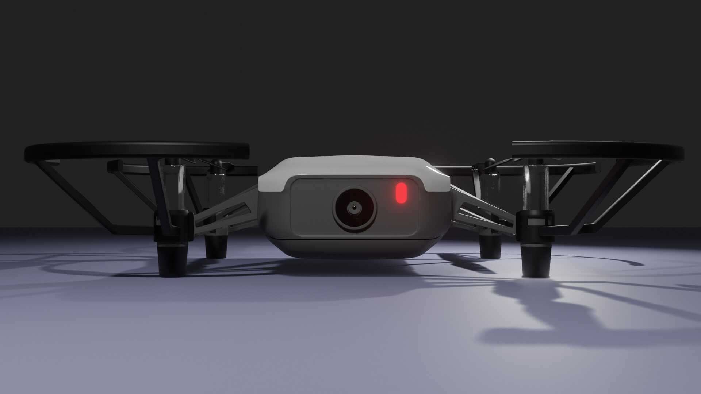
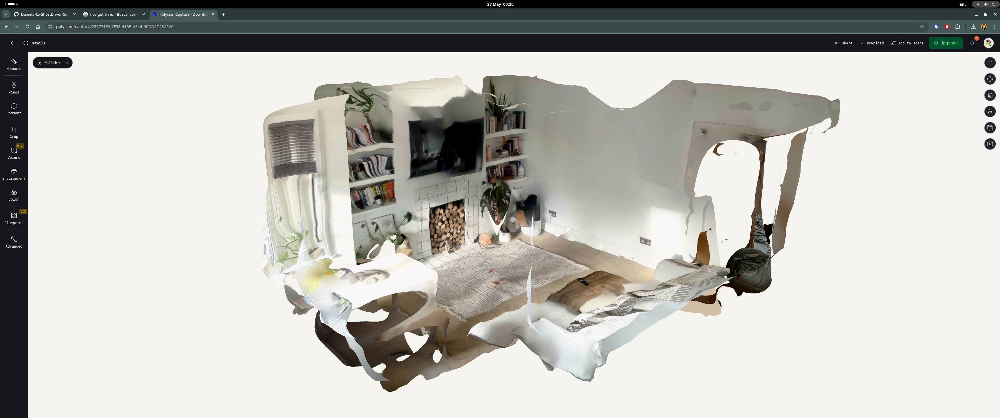
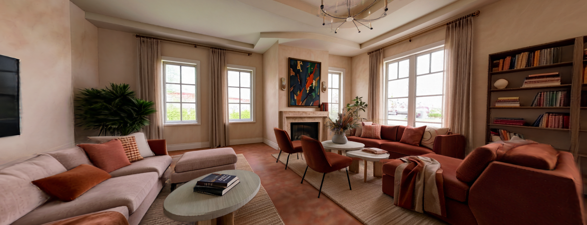

<pre>🟣 Description</pre>
This project focuses on training a drone inside Unreal Engine and deploying the learned behaviour onto a real-world drone. I'll be working with robotic simulation in Unreal, developing reinforcement learning policies, potentially exploring LLMs, and using 3D world creation tools.

<pre>🟣 Real world description</pre>
The drone's trajectory begins in the living room and proceeds up a staircase and into my room. The staircase is narrow, and architectural elements such as an angled ceiling introduce further obstacles that increase the complexity of autonomous navigation.

<pre>🟣 Technical stack</pre>

- `Unreal Engine 5.6`
- `Linux Fedora 42`

<pre>🟣 Drone Model</pre>



The drone used in this project is the DJI Ryze Tello. It includes a vision‑positioning system with a downward‑facing camera and a 3D infrared module located on the underside of the aircraft. The drone operates at altitudes ranging from 1 to 98.4 ft. Its specifications are:

<pre>🟣 Drone Specifications</pre>

|Model| TLW004              | 
| --- |---------------------| 
|Weight| 87 gr               | 
|Max Speed| 28.8 kph            | 
|Max flight time| 13 minutes          | 
|Max image size| 2592x1936           |
|Video recording | HD: 1280x720        |
| FPS | 30                  |
| Video format | MP4                 |

<pre>🟣 Project Overview</pre>

```angular2html
- Design the pipeline with the best tools I can test to create a virtual replica of three environments (living room, staircase, and bedroom) that closely match the real world
- Research databases to train the drone across diverse indoor environments and expose it to varied movement scenarios
- Train a virtual drone using reinforcement learning, enabling it to learn movement, stability, obstacle avoidance, and autonomous navigation through interaction with the simulated environment
- Export the trained policy and deploy it on a real Ryze Tello (DJI), enabling the physical drone to perform autonomous movement in the real world using the skills learned in simulation

```

<pre>🟣 3D environment creation </pre>

<pre>🟣 1. Progress Documentation </pre>

The Ryze Tello (DJI) primarily perceives its environment through its forward-facing camera, making realistic visual environments critical for training. That's why my focus is on representing the world as realistically as possible. Below you will find the different techniques I've explored to achieve this goal, and further on, my pipeline for this task.

<pre>🟣 2. Geometry reconstruction tools (point clouds) </pre>

After weeks of testing, I decided to move on from photogrammetry techniques for the following reasons:

```angular2html
- Heavily dependent on local hardware. My RTX 5060 with 8 GB VRAM and 16 GB RAM is a decent setup, but it falls behind when processing scenes with more than 400 images. Serious photogrammetry projects can require up to 5,000 images for indoor environments.
- Many apps claim you can do photogrammetry with a phone, but phone cameras simply don't deliver the quality needed. Dedicated cameras like the Canon 450D with proper lenses give better results, but cost around £150 used — not worth the investment for this project.
- Shooting technique has a real impact on results. Blur is the enemy of photogrammetry, so you often end up reshooting locations multiple times, which is time-consuming.
```

Below is a summary of the tools I tested and their results:

| Tools | Results                                                                                                                                                                                                                                                                                                                                                                             | Image                         |
|-------|-------------------------------------------------------------------------------------------------------------------------------------------------------------------------------------------------------------------------------------------------------------------------------------------------------------------------------------------------------------------------------------|-------------------------------|
|`Polycam`| Produces deficient results, not accurate enough for reliable drone-training environments. Tested with an iPhone 13 Pro, iPhone 15, and iPhone 16 Pro Max.                                                                                                                                                                                                                           |  |
|`RealityScan`| So far, the app delivering the best results, unfortunately, for Linux users it only runs under Wine, which means no export, import, or mesh manipulation tools are available. |    |

<pre>🟣 3. Generative techniques tools (gaussian splats) </pre>

Alongisde, I've been exploring generative techniques and so far, my favorite tool and the one I'm going to use to this step is `Marble Labs`, great gaussian splats reconstruction.



<pre>🟣 4. 3DGS in Unreal Engine </pre>

Natively, Unreal Engine doesn't support 3D Gaussian Splats, so I had to search for plugins. Most of them were also only packaged for Windows, which is a very common issue with plugins. Rebuilding and configuring the source code for Linux compatibility isn't too much effort in theory, but most public repos don't include the plugin's source code, making it impossible to get them working on Linux. This is what I found with the following plugins:

| Plugin                               | Link                        | Opinion |
|--------------------------------------|-----------------------------|---------|
| `unreal-splat`                       | [GitHub](https://github.com/JI20/unreal-splat) | Open source, compiles on Linux, but I haven't tested it yet. |
| `voligna`                            | [Website](https://web.volinga.ai/#VolingaPlugin) | Paid plugin, doesn't compile on any Linux version I tried. Source code is not available, so there is nothing I can do about it. |
| `MSLabsGaussian`                     | [GitHub](https://github.com/mlslabs/MLSLabsGaussianSplattingRenderer-UE) | Open source but no source code available. Compiled plugin works on Windows only. |
| `xverse`                             | [GitHub](https://github.com/xverse-engine/XScene-UEPlugin) | Open source but no source code available. Compiled plugin works on Windows only. |
| `NanoGaussianSplatting`              | [GitHub](https://github.com/TimChen1383/NanoGaussianSplatting) | Open source and the best one! Compiles on Linux and mimics Nanite's rendering system, allowing efficient 3DGS rendering. |
| `GaussianSplatting`                  | [GitHub](https://github.com/Italink/GaussianSplattingForUnrealEngine) | Open source, compiles on Linux, but not optimised and very strict with .ply file formatting — breaks easily with compressed .ply files. |

<pre>🟣 5. Virtual environment pipeline </pre>

<pre>🟣 3DGS Database training environments </pre>

## Resources 
- https://www.youtube.com/watch?v=tjOZoX4DZGI&t=90s
- https://ilyalandshut.artstation.com/projects/xzWeDY