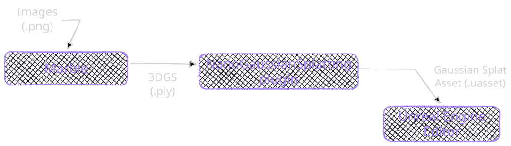

<!-- toc -->

- [🟣 Description](#%F0%9F%9F%A3-description)
- [🟣 Real-World Description](#%F0%9F%9F%A3-real-world-description)
- [🟣 Technical Stack](#%F0%9F%9F%A3-technical-stack)
- [🟣 Hardware Setup](#%F0%9F%9F%A3-hardware-setup)
- [🟣 Drone Model](#%F0%9F%9F%A3-drone-model)
- [🟣 Project Overview](#%F0%9F%9F%A3-project-overview)
- [🟣 3D Environment Creation for Training](#%F0%9F%9F%A3-3d-environment-creation-for-training)
  * [🟣 1. Progress Documentation](#%F0%9F%9F%A3-1-progress-documentation)
  * [🟣 2. Geometry Reconstruction Tools (Point Clouds)](#%F0%9F%9F%A3-2-geometry-reconstruction-tools-point-clouds)
  * [🟣 3. Generative Tools (Gaussian Splats)](#%F0%9F%9F%A3-3-generative-tools-gaussian-splats)
  * [🟣 4. 3DGS in Unreal Engine](#%F0%9F%9F%A3-4-3dgs-in-unreal-engine)
  * [🟣 5. Virtual Environment Pipeline](#%F0%9F%9F%A3-5-virtual-environment-pipeline)
  * [🟣 3DGS Pre-Training Environments (Dataset)](#%F0%9F%9F%A3-3dgs-pre-training-environments-dataset)
- [🟣 Unreal Simulation Setup](#%F0%9F%9F%A3-unreal-simulation-setup)
  * [🟣 3D Drone Model](#%F0%9F%9F%A3-3d-drone-model)
    + [🟣 1. Body Dimensions](#%F0%9F%9F%A3-1-body-dimensions)
    + [🟣 2. General Specs](#%F0%9F%9F%A3-2-general-specs)
    + [🟣 3. Front Camera](#%F0%9F%9F%A3-3-front-camera)
    + [🟣 4. Vision Positioning System](#%F0%9F%9F%A3-4-vision-positioning-system)
  * [🟣 Pre-Training Environments (InteriorGS)](#%F0%9F%9F%A3-pre-training-environments-interiorgs)
- [🟣 6. Pre-Validation: Pipeline Performance and Architecture Decisions](#%F0%9F%9F%A3-6-pre-validation-pipeline-performance-and-architecture-decisions)
  * [🟣 6.1 Why Unreal Engine Is Expensive (and Why That Matters for RL)](#%F0%9F%9F%A3-61-why-unreal-engine-is-expensive-and-why-that-matters-for-rl)
  * [🟣 6.2 Editor Mode vs. Packaged Builds](#%F0%9F%9F%A3-62-editor-mode-vs-packaged-builds)
  * [🟣 6.3 Why UnrealCV as the RL Bridge?](#%F0%9F%9F%A3-63-why-unrealcv-as-the-rl-bridge)
  * [🟣 6.4 First Test: One Environment + Drone Setup](#%F0%9F%9F%A3-64-first-test-one-environment--drone-setup)
    + [Environment Selection](#environment-selection)
    + [Get the Drone Flying in the Environment](#get-the-drone-flying-in-the-environment)
    + [Control the Drone with Commands Through UnrealCV](#control-the-drone-with-commands-through-unrealcv)
    + [Test Drone Collisions and Physics](#test-drone-collisions-and-physics)
    + [References](#references)

<!-- tocstop -->

## 🟣 Description

This project focuses on training a drone inside `Unreal Engine` and deploying the learned behaviour onto a real-world drone. I'll be working with `robotic simulation` in Unreal, developing `reinforcement learning policies`, potentially exploring `agentic LLMs`, and using `3D world creation tools`.

## 🟣 Real-World Description

The drone's trajectory begins in the living room and proceeds up a staircase and into my room. The staircase is narrow, and architectural elements such as an angled ceiling introduce further obstacles that increase the complexity of autonomous navigation.

## 🟣 Technical Stack

- `Unreal Engine 5.6`
- `Linux Fedora 42`
- `NanoGaussianSplatting` (Gaussian splat rendering in Unreal)
- `UnrealCV`

## 🟣 Hardware Setup

| Component | Specification                                |
|-----------|----------------------------------------------|
| `CPU`     | Intel Core i5-14400F (10 cores / 20 threads) |
| `GPU`     | NVIDIA GeForce RTX 5060 (8 GB VRAM)          |
| `RAM`     | 16 GB                                        |
| `Storage` | 1 TB NVMe SSD                                |

## 🟣 Drone Model


The drone used in this project is the `DJI Ryze Tello`. It has a front-facing camera and a vision positioning system with a 3D infrared module on the underside of the aircraft.

## 🟣 Project Overview

- Design the pipeline with the best tools I can test to create virtual replicas of three environments (living room, staircase, and bedroom) that closely match the real world
- Research datasets to train the drone across diverse indoor environments and expose it to varied movement scenarios
- Set up Unreal for simulation (drone physics, camera sensor, and environment import)
- Train a virtual drone using reinforcement learning, so it learns movement, stability, obstacle avoidance, and autonomous navigation by interacting with the simulated environment
- Export the trained policy and deploy it on a real Ryze Tello (DJI), so the physical drone can move autonomously in the real world using the skills learned in simulation

## 🟣 3D Environment Creation for Training

### 🟣 1. Progress Documentation

The `Ryze Tello (DJI)` perceives its environment mainly through its front-facing camera, which makes realistic visual environments critical for training. That's why my focus is on representing the world as realistically as possible. Below are the techniques I've explored to achieve this, followed by my pipeline for this task.

### 🟣 2. Geometry Reconstruction Tools (Point Clouds)

After weeks of testing, I decided to move on from photogrammetry for the following reasons:

- **Hardware limits:** Photogrammetry depends heavily on local hardware. My RTX 5060 with 8 GB VRAM and 16 GB RAM is a decent setup, but it falls behind when processing scenes with more than 400 images. Serious indoor photogrammetry projects can require up to 5,000 images.
- **Camera quality:** Many apps claim you can do photogrammetry with a phone, but phone cameras don't deliver the quality needed. Dedicated cameras like the Canon 450D with proper lenses give better results, but cost around £150 used, which isn't worth the investment for this project.
- **Shooting technique:** Technique has a real impact on results. Blur is the enemy of photogrammetry, so you often end up reshooting locations multiple times, which is time-consuming.

Below is a summary of the tools I tested and their results:

| Tool          | Results | Image |
|---------------|---------|-------|
| `Polycam`     | Results weren't accurate enough for reliable drone-training environments. Tested with an `iPhone 13 Pro`, `iPhone 15`, and `iPhone 16 Pro Max`. |  |
| `RealityScan` | The app with the best results so far. Unfortunately, on `Linux` it only runs under `Wine`, so no export, import, or mesh editing tools are available. |  |

### 🟣 3. Generative Tools (Gaussian Splats)

Alongside photogrammetry, I've been exploring generative techniques. So far, my favourite tool, and the one I'm using for this step, is `Marble` by World Labs.


### 🟣 4. 3DGS in Unreal Engine

`Unreal Engine` doesn't support `3D Gaussian Splats` natively, so I had to look for plugins. Most were packaged for `Windows` only, which is a very common issue with plugins. Rebuilding the source code for `Linux` isn't much effort in theory, but most public repos don't include the plugin's source code, which makes it impossible to get them working on `Linux`. Here's what I found:

| Plugin                  | Link | Opinion |
|-------------------------|------|---------|
| `unreal-splat`          | [GitHub](https://github.com/JI20/unreal-splat) | Open source and compiles on Linux, but I haven't tested it yet. |
| `Volinga`               | [Website](https://web.volinga.ai/#VolingaPlugin) | Paid plugin. Doesn't compile on any Linux version I tried, and the source code isn't available, so there's nothing I can do about it. |
| `MLSLabsGaussian`       | [GitHub](https://github.com/mlslabs/MLSLabsGaussianSplattingRenderer-UE) | Public repo, but the source code isn't included. The compiled plugin only works on Windows. |
| `XScene`                | [GitHub](https://github.com/xverse-engine/XScene-UEPlugin) | Public repo, but the source code isn't included. The compiled plugin only works on Windows. |
| `NanoGaussianSplatting` | [GitHub](https://github.com/TimChen1383/NanoGaussianSplatting) | Open source and the best one. Compiles on Linux and mimics Nanite's rendering system, allowing efficient 3DGS rendering. |
| `GaussianSplatting`     | [GitHub](https://github.com/Italink/GaussianSplattingForUnrealEngine) | Open source and compiles on Linux, but not optimised and very strict about `.ply` formatting. It breaks easily with compressed `.ply` files. |

### 🟣 5. Virtual Environment Pipeline



### 🟣 3DGS Pre-Training Environments (Dataset)

Hugging Face hosts a dataset called [`InteriorGS`](https://huggingface.co/datasets/spatialverse/InteriorGS). It provides high-quality 3D Gaussian Splatting scenes with semantic bounding boxes and occupancy maps for each scene, 1,000 environments in total.

## 🟣 Unreal Simulation Setup

In this step, the following elements need to be set up and imported into Unreal:

- The 3D model of the drone
- The 3DGS of the real-world replica environment, including its bounding boxes and collision mesh, via NanoGaussianSplatting
- The 3DGS pre-training environments (InteriorGS dataset)

### 🟣 3D Drone Model

The 3D model has to match the real drone in the following areas.

#### 🟣 1. Body Dimensions

| Description                  | Dimensions (bounding box) |
|------------------------------|---------------------------|
| `Body`                       | 98 × 92.5 × 41 mm         |
| `Body + propellers`          | 174 × 170 × 41 mm         |
| `Body + propellers + guards` | 188 × 183 × 46 mm         |

#### 🟣 2. General Specs

| Property    | Real Tello value |
|-------------|------------------|
| `Weight`    | 87 g             |
| `Max speed` | 28.8 km/h        |

#### 🟣 3. Front Camera

| Property           | Real Tello value                 |
|--------------------|----------------------------------|
| `Position on body` | Front-centre, slightly below top |
| `FOV`              | 82.6°                            |
| `Max image size`   | 2592 × 1936                      |
| `Video recording`  | HD: 1280 × 720                   |
| `FPS`              | 30                               |

#### 🟣 4. Vision Positioning System

| Property             | Real Tello value |
|----------------------|------------------|
| `Camera`             | Front            |
| `3D infrared module` | Underside        |

### 🟣 Pre-Training Environments (InteriorGS)

TODO: Curate and select the environments to use for training. At this stage I'm planning on up to 50 environments.

**Note:** I ran into an issue importing the InteriorGS environment into Unreal. I used the USD Importer plugin (available in Unreal's plugin list), and the collision meshes came in oversized, roughly 1000x too large. The scale options in the USD import settings didn't fix it for these assets, so I had to bake the scale into the scene before importing it.

## 🟣 6. Pre-Validation: Pipeline Performance and Architecture Decisions

Before committing to a full training pipeline, I needed to answer a practical question: **can this stack actually run fast enough to train RL?**

The challenge is that this pipeline stacks two computationally expensive processes: Unreal Engine rendering and reinforcement learning training. Each one alone is resource-heavy, and combined, poor architectural choices could make training unfeasibly slow. So before scaling to 50 environments, I ran a series of tests to validate my assumptions and benchmark the stack.

---

### 🟣 6.1 Why Unreal Engine Is Expensive (and Why That Matters for RL)

Unreal Engine is a real-time 3D engine built for cinematic-quality rendering. That power comes at a cost:

- **Shader compilation:** The first time you open a project, Unreal compiles thousands of shaders. These are cached for later runs, but the initial hit is significant, and every new environment triggers new compilations.
- **Editor overhead:** Running inside the Unreal Editor loads the full UI, debug tools, viewport rendering, and asset management systems. All of this consumes GPU and CPU resources that could otherwise go to simulation and training.
- **Memory footprint:** Between the editor, the 3D Gaussian Splat visual layer, and the SAGE-3D collision meshes, a single environment can consume several GB of VRAM and RAM.

In a sim2real pipeline where the RL agent needs thousands of episodes, every lost frame per second adds up to hours of lost training time. This is the biggest concern in the simulation phase. The steps below describe how to validate which approach works best, along with a small test to run before scaling up.

### 🟣 6.2 Editor Mode vs. Packaged Builds

I ran the same environment in two configurations, fetching 300 frames of shape `(84, 84, 3)`:

| Metric        | Editor Mode | Packaged Build |
|---------------|-------------|----------------|
| Sustained FPS | 3.0         | 37.7           |
| Total time    | 100.00 s    | 7.97 s         |
| Avg per frame | 333.3 ms    | 26.6 ms        |

**Note:** While monitoring performance with `btop` in editor mode, I noticed the CPU cores were heavily loaded while the GPU was barely used during frame fetching. This suggests the bottleneck is on the CPU side rather than in rendering.

**Result:** The packaged build ran about 12.5x faster than the editor. This makes sense: the packaged build strips out the editor UI, debug tools, and asset browser, leaving only the runtime renderer and game logic. For training, there is no reason to run from the editor.

**Decision:** All 50 environments will be packaged into standalone builds before training begins. The packaging cost is paid once, and the FPS gain pays off on every training episode.

### 🟣 6.3 Why UnrealCV as the RL Bridge?

I needed a plugin that could:

1. Accept actions from a Python-based RL framework (movement and rotation commands)
2. Return observations (RGB, depth) to Python
3. Run over TCP, so the gym and the renderer can be separate processes
4. Work with packaged builds, not just the editor

UnrealCV meets all of these requirements. It runs a TCP server (default port 9000) inside the Unreal process, and the Python side connects as a client. The communication loop is:

```
Python Gym  ---(action)-->  UnrealCV TCP  -->  Drone pawn moves
Python Gym  <---(obs)-----  UnrealCV TCP  <--  Camera captures frame
```

The reward is then computed on the Python side from the returned observations. This architecture also lets me run multiple packaged environments in parallel on different ports for future scaling.

### 🟣 6.4 First Test: One Environment + Drone Setup

#### Environment Selection

The goal here is to pick one environment and use it to set up the whole pipeline, which we can then use to pre-train the drone on basic movement. I chose a store environment with many stands, which forces the drone to navigate between them.

**Note:** Environments like this one, with many detailed products, can show visual artifacts that look distorted when you move through them. I suspect this could add noise to the drone's learning, so we'll see how it goes.

**Gaussian splats + collision mesh in Unreal**


**Gaussian splats**


**Collision mesh**


#### Get the Drone Flying in the Environment

#### Control the Drone with Commands Through UnrealCV

#### Test Drone Collisions and Physics

#### References

- [Video: <short description>](https://www.youtube.com/watch?v=tjOZoX4DZGI&t=90s)
- [Ilya Landshut on ArtStation: <short description>](https://ilyalandshut.artstation.com/projects/xzWeDY)
- [SuperSplat editor (online Gaussian splat editor)](https://superspl.at/editor)